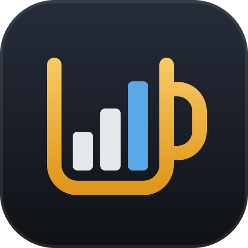
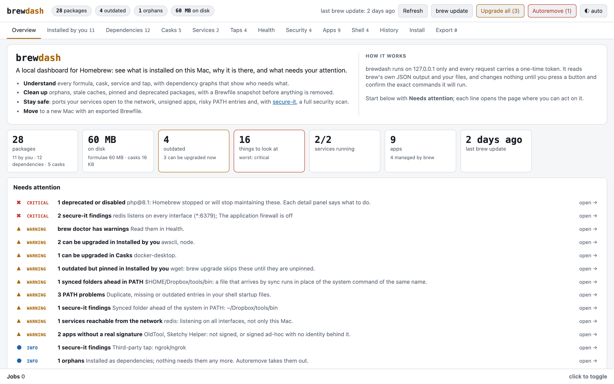
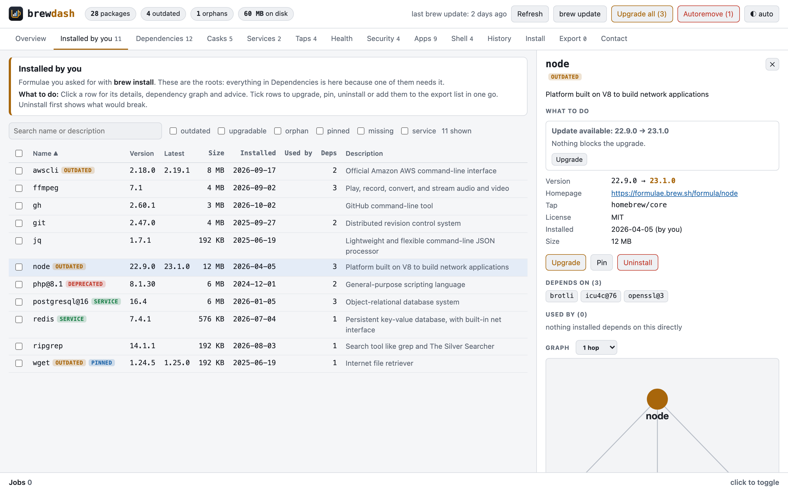
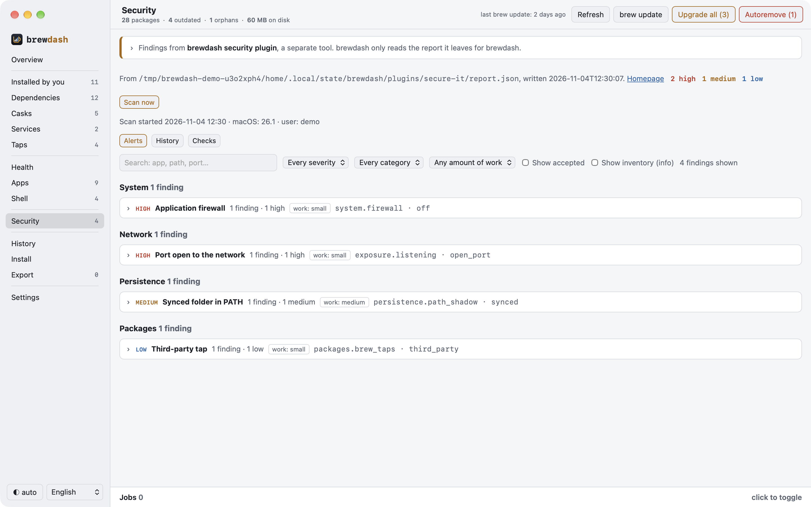
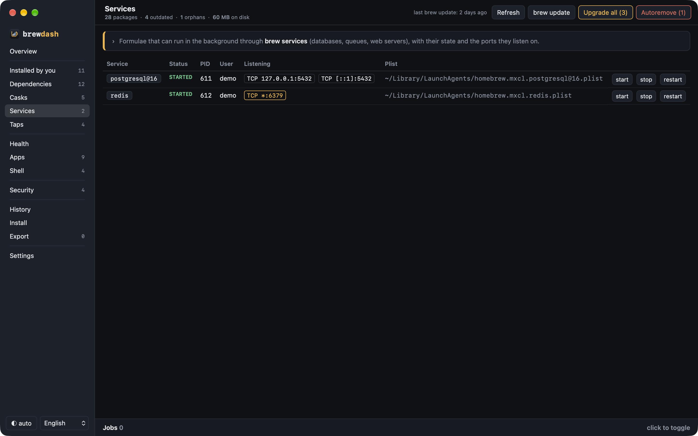
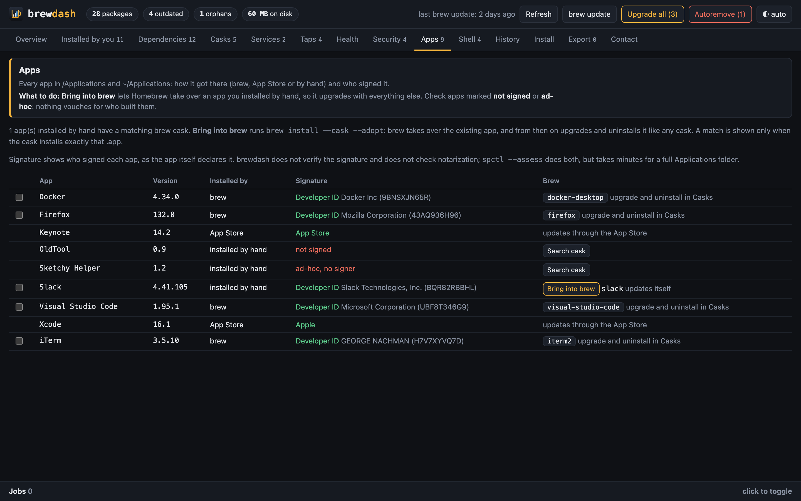

# brewdash

**A dashboard for Homebrew that runs on your Mac.** See what is installed, why
it is there, what is outdated or broken, and what needs your attention. Then
fix it in the app, with every command shown to you before it runs.

[](LICENSE)


<picture>
  <source media="(prefers-color-scheme: dark)" srcset="docs/screenshots/overview-dark.png">
  
</picture>

## Why

`brew list` tells you *what* is installed. It does not tell you why a package
is there, what still needs it, whether removing it breaks something, which
services listen on your network, or which apps you installed by hand that
brew could manage. brewdash answers those questions on one page, and every
line of its **Needs attention** list opens the page where you can act on it.

## Features

- **Overview**: totals, disk use, outdated packages, running services, and a
  *Needs attention* list ordered worst first. Charts show what is installed,
  how your apps got there, the largest packages, the most depended-on
  packages, and installs per month.
- **Packages** (*Installed by you*, *Dependencies*, *Casks*): version, latest
  version, size on disk, install date, and how many packages use each one.
  Filter by outdated, orphan, pinned, missing dependency or service.
- **Detail panel**: description, homepage, tap, caveats, what a package
  depends on and what depends on it (directly or indirectly), and an
  interactive dependency graph.
- **Advice**: for an outdated, pinned, deprecated, disabled or broken package,
  brewdash says whether brew can still update it, whether a replacement is
  already installed, and whether it is safe to remove. Each suggestion is a
  button.
- **Services**: start, stop and restart `brew services`, and see the ports each
  one listens on. A port open to the network is flagged.
- **Taps**: where your formulae come from, which third-party taps are in use,
  and which are not used by anything. Select taps to untap them.
- **Health**: `brew doctor`, missing dependencies, deprecated packages, orphans
  and what `brew cleanup` would free.
- **Plugins**: findings from separate tools such as
  the [brewdash security plugin](https://github.com/lemiorhan/brewdash-plugin-security), one tab each, shown next
  to the packages, taps and shell files they concern (see below).
- **Apps**: every app in `/Applications` and `~/Applications`, how it got there
  (brew, App Store or by hand), and who signed it. **Bring into brew** replaces
  an app you installed by hand with the same app from its cask. Uninstall a brew app, or
  move an app you installed by hand to the Trash.
- **Shell**: the `PATH` lines and tools set up in your shell startup files.
  brewdash flags entries that are missing, duplicated, pinned to one version,
  left over from an Intel Mac, or that put a cloud-synced folder (Dropbox,
  iCloud Drive, `~/Library/CloudStorage`) ahead of the system folders.
- **Install**: search Homebrew and preview what an install would bring with it.
- **Export**: build a Brewfile to set up another Mac.
- **History**: every action, with a Brewfile snapshot before each removal.
- **Settings**: the update channel, automatic updates, and where to find the
  source and report bugs.
- **Light and dark mode**: follows your system, or pick one with the theme
  button.

| | |
|---|---|
|  |  |
|  |  |

## Install

brewdash needs macOS, [Homebrew](https://brew.sh) and Python 3.9 or newer. The
`python3` that ships with the Xcode Command Line Tools is enough. It uses the
standard library only; Cytoscape.js is vendored in `web/vendor/`.

```sh
brew trust lemiorhan/brewdash && brew install --cask lemiorhan/brewdash/brewdash
```

The cask comes from brewdash's own tap,
[lemiorhan/homebrew-brewdash](https://github.com/lemiorhan/homebrew-brewdash).
Homebrew loads a cask from a tap that is not its own only after
`brew trust`. That command came with Homebrew 5.1.15, so an older Homebrew
stops there; run `brew update` first. The cask puts the latest release of
`brewdash.app` in `/Applications`, signed with a Developer ID and notarized
by Apple. You can also
[download the app](https://github.com/lemiorhan/brewdash/releases/latest/download/brewdash-macos.zip),
unzip it and move it to your Applications folder.

If a `brewdash.app` is already in `/Applications`, for instance one that
`install.sh` built, Homebrew stops with *It seems there is already an App*.
Add `--force` to replace it. Your settings stay in `~/.local/state/brewdash`.

```sh
brew install --cask --force lemiorhan/brewdash/brewdash
```

brewdash opens in its own window, with a menu bar, ⌘, for Settings, ⌘R to
reload, ⌘W to close the window, zoom and full screen, and a save dialog for
the Brewfile. Links to other sites open in your browser. From then on:

- **Open** brewdash from Launchpad, Spotlight or the Dock. It starts the
  server and opens the dashboard.
- **Click its Dock icon** to open the dashboard again, also after you closed
  the window.
- **Quit** it (⌘Q) to stop the server. If the app stops without quitting, the
  server notices and stops as well.

To remove it:

```sh
brew uninstall --cask brewdash          # keeps your settings and Brewfile snapshots in ~/.local/state/brewdash
brew uninstall --cask --zap brewdash    # deletes them too
```

### With the install script

[`install.sh`](install.sh) builds `brewdash.app` on your Mac instead, with
`swiftc` from the Command Line Tools, and signs it ad-hoc. It puts the app in
`/Applications` (or `~/Applications` when you cannot write to
`/Applications`) and opens it.

```sh
curl -fsSL https://raw.githubusercontent.com/lemiorhan/brewdash/master/install.sh | bash                  # install or update
curl -fsSL https://raw.githubusercontent.com/lemiorhan/brewdash/master/install.sh | bash -s -- --uninstall # remove it
```

A `brewdash.app` in the other Applications folder is removed, so only one
brewdash is installed. `--uninstall` keeps your settings and Brewfile
snapshots, like the cask.

The top of `install.sh` lists the settings it reads, such as
`BREWDASH_APP_DIR` for another folder and `BREWDASH_REF` for a tag, branch or
commit other than the latest release.

### Updates

The app updates itself from GitHub. Pick how on the **Settings** page:

- **Stable** installs GitHub's latest release, the one made from the highest
  `vX.Y.Z` tag. This is the default.
- **Beta** installs the `beta` prerelease: the latest build made from
  anything but a `vX.Y.Z` tag.
- **Update by itself** (on by default) checks GitHub a minute after the app
  starts and every hour after that, and installs a newer version when there
  is one. The intervals are `UPDATE_FIRST_CHECK_SECONDS` and
  `UPDATE_CHECK_SECONDS` in `brewdash.py`.
- **Check now** asks GitHub straight away, and **Update to …** installs what
  the channel is at. When you switch from Beta back to Stable, the release can
  be older than what you have; the app never goes back on its own, only when
  you press **Go back to …**.

An update runs the `install.sh` inside the app with the release to install.
It downloads the release's signed and notarized ZIP and takes it only once
Gatekeeper accepts it. Then `install.sh` quits brewdash, replaces the app and opens it again. If it
fails before it quits brewdash, the Settings page shows the last line of its log,
`~/.local/state/brewdash/update.log`; a failure after it has quit brewdash is
only in that log. Your choices are kept in
`~/.local/state/brewdash/settings.json`.

An app installed before brewdash could update itself, an app built from
`BREWDASH_TARBALL`, and a copy run from a git checkout do not update
themselves. Install the cask to get an app that does, with `--force` when a
`brewdash.app` is already there.

### From the source

```sh
git clone https://github.com/lemiorhan/brewdash.git
cd brewdash
python3 brewdash.py                            # opens your browser
python3 brewdash.py --port 8765 --no-browser   # fixed port, no browser
bash macos/build-app.sh                        # build brewdash.app into build/
```

To look around without touching your own setup, run the demo. It serves
made-up data and only prints the commands it would run:

```sh
python3 scripts/demo.py
```

brewdash does not run `brew update` on start. Use the **brew update** button;
the header shows when it last ran.

## How it works

brewdash is one Python file that serves a small web page. It reads Homebrew's
own JSON output (`brew info --json=v2 --installed`, `brew outdated`,
`brew services`, `brew tap-info`) and builds the model the page shows. Disk
sizes, `brew doctor`, the app scan, signatures and ports load in the
background after the first view.

### Actions

Every action opens a confirmation dialog with the exact commands it will run.
Uninstall also lists the dependencies that would become orphans. If installed
packages still need what you are removing, brew refuses a plain uninstall, so
the dialog offers two ways instead: **Uninstall them too** adds those packages,
and **Uninstall anyway and break them** runs
`brew uninstall --ignore-dependencies` and names what may stop working.

One brew command runs at a time; later ones queue, and their output streams
into the Jobs panel. When a command needs your `sudo` password, macOS asks for
it in a password dialog (brewdash sets `SUDO_ASKPASS`, which brew passes on to
`sudo`). If you cancel the dialog, the command fails and the panel shows the
command to run in Terminal instead.

**Untap** applies only to taps nothing is installed from; uninstall their
packages first. **Move to Trash** has Finder move an app brew did not install
to the Trash, where you can still get it back until you empty it. It is not
offered for Apple's own apps or for brewdash, and the settings and caches the
app left in `~/Library` stay where they are.

Before every uninstall, autoremove and multi-package action, brewdash writes a
Brewfile snapshot to `~/.local/state/brewdash/brewfiles/`. Restore one with
`brew bundle install --file=<snapshot>`. The action log is
`~/.local/state/brewdash/history.jsonl`.

### Selecting several

Tick packages, taps or apps in any tab. The bar above the table shows each
action with the number of selected items it applies to: Upgrade, Pin, Unpin,
Uninstall and Add to list. An action that applies to none of them is disabled,
and its tooltip says why.

### Moving to another Mac

Select what you want to keep and press **Add to list**. The list is stored in
`~/.local/state/brewdash/list.json` and kept between runs. The **Export** tab
groups it into taps, formulae and casks and shows the Brewfile. Taps that
tap-qualified names need are added on their own. Entries from third-party
taps get `trusted: true`, as `brew bundle dump` writes them. Dependencies do
not need to be on the list; brew installs them anyway.

On the new Mac:

```sh
/bin/bash -c "$(curl -fsSL https://raw.githubusercontent.com/Homebrew/install/HEAD/install.sh)"
brew bundle --file=Brewfile
```

### Apps and signatures

An app installed by hand is matched to a cask only when the cask's name is the
app's name and `brew info --cask` shows that the cask installs exactly that
`.app`. **Bring into brew** renames the app in its own folder to
`.<name>.app.brewdash-backup`, then runs
`brew install --cask --appdir=<that folder> <cask>`. The backup is removed only
when brew succeeds and an app is at the old path again: brew also succeeds
without installing anything for a cask it counts as installed. Otherwise the
backup is renamed back; when brew left something at the app's path, brewdash
overwrites nothing and the job log says where the backup is. The confirm
dialog asks you to quit the app first. From then on the app upgrades and
uninstalls like any other cask. `brew install --adopt` is not used: unless the
cask updates itself, it refuses an app whose version is not the cask's. Only
the `.app` moves; the app's settings in `~/Library` are not touched.

An app whose version is newer than its cask's is not offered, and the server
refuses it: brew would install the older version over it, and settings the
newer version already converted may not open in the older one. Versions are
compared by their leading numbers (`2.10` is newer than `2.9`, `1.0` equals
`1`, the cask's `,build` part is ignored). An app with no version or one its
Info.plist stores as a number, or a cask that is always `latest`, counts as
not newer. The check uses the last app
scan, so an app that updated itself after it is not seen until the next
refresh.

The signature column comes from `codesign -dv`: who signed the app, as the app
declares it. brewdash does not verify the signature and does not check
notarization (`spctl --assess` does both, but takes minutes for a full
Applications folder). Apps that are not signed at all, or signed ad-hoc with
no identity behind them, are listed under *Needs attention*. brewdash.app
is signed ad-hoc too when `install.sh` builds it on your Mac; it
shows as *built on this Mac (ad-hoc)* and is left out of that list.

### Listening ports

For each running brew service, brewdash asks `lsof` which TCP and UDP ports
its process listens on. A port bound to every interface (`*`) or to a
non-loopback address can be reached from other machines on your network, so
it is flagged.

### Shell files

brewdash reads only the `PATH`, `source`, `.` and `eval` lines of `.zprofile`,
`.zshenv`, `.zshrc`, `.profile`, `.bash_profile` and `.bashrc`, and it never
writes to them. A cloud-synced folder ahead of `/usr/bin` in `PATH` is
flagged even when it is harmless today: a file that arrives through sync, from
another device or a shared folder, would run in place of the system command
of the same name.

## Plugins

A plugin is a separate tool that writes its findings to a JSON report.
brewdash reads that report and gives the plugin its own tab, in a group of its
own above **History**. The tab has three views:

- **Alerts**: the findings grouped by category, then by topic, worst first.
  Search them, filter by severity, category or effort, and show the accepted
  findings and the info lines when you want them. A topic can explain what it
  checks, why it matters and how attackers use it, with its sources.
- **History**: the open findings of each kept run, as a chart and a table, and
  what came and went between runs.
- **Checks**: each check that failed or was skipped in a kept run, how often,
  and why the last time.

Open findings also show up across brewdash. An open finding is one that is
not accepted and not info:

- high and critical findings appear as *critical* in *Needs attention*,
  medium as *warning*, low as *info*;
- a finding about a Homebrew package or its launchd job appears in that
  package's detail panel;
- a finding about a tap marks the tap in **Taps**;
- PATH and shell findings link to **Shell**.

A plugin is data, not code. brewdash runs nothing a plugin's files say: it
type-checks every field before it uses it and escapes it before it shows it.
Each finding's fix and accept commands are there for you to copy into
Terminal.

### The brewdash security plugin

The [brewdash security plugin](https://github.com/lemiorhan/brewdash-plugin-security)
is a macOS security scanner, and it is in brewdash's built-in catalog. Its tab
is **Security**. The plugin used to be called secure-it, and its command and
paths still carry that name. Without it, the tab says what it is and how to
install it. Once `/usr/local/bin/secure-it` is there, the tab has a **Scan
now** button. It runs `/usr/bin/sudo -A /usr/local/bin/secure-it scan
--exit-zero` after you confirm, and macOS asks for your password. The plugin
then writes `~/.local/state/brewdash/plugins/secure-it/report.json`, and the
tab shows the new findings. A version that writes `~/secure-it/report.json`
instead is older than this brewdash: the tab says to update it and gives the
commands, and brewdash does not read that file. With `--exit-zero` a scan that
finds open alerts exits with 0, because sudo also exits with 1 when you cancel
the password dialog; brewdash shows any other exit code as a failed job. The
plugin does not scan on its own; it scans when you start a scan.

Only a plugin in the catalog can be started from brewdash. The command is in
`brewdash.py`, not in a file anyone else can write.

brewdash also runs it only when root alone can change the plugin's files. The
catalog names them, the same three paths that the plugin's own integrity check
covers: `/usr/local/bin/secure-it`, which only hands over to
`/usr/local/libexec/secure-it`, where the plugin's code is, and
`/Library/Application Support/secure-it`, where it keeps its state. Each of
them, everything inside them, and every folder above them must belong to root,
with no write access for other users, and none of them may be a symlink. A
folder above may be writable by the `wheel` group, whose only member on macOS
is root. A folder that gives other users no access at all is not looked into,
because only root can reach inside. brewdash checks this when it shows the tab
and again when you start a scan. Otherwise the tab names the path someone else
can change, and offers no **Scan now**. Before an install, the same check
covers the folders the plugin would go into. On an Intel Mac, Homebrew gives
`/usr/local/bin` to your user, so there the tab says the plugin cannot be
installed safely and shows no install commands. The check does not cover
`/usr/bin/python3`, which the plugin runs, or the Xcode or Command Line Tools
Python that it hands over to.

### Adding a plugin

Put a manifest at `~/.local/state/brewdash/plugins/<id>.json`. The `<id>` is
lowercase letters, digits and hyphens, up to 40 characters, starting with a
letter or a digit; an id from the catalog is taken.

```json
{"schema": 1, "name": "Acme", "report": "~/acme/report.json", "homepage": "https://acme.example"}
```

`report` is an absolute path or one under `~/`. `homepage` is shown as a link
only when it starts with `https://`. A manifest plugin has no **Scan now**:
brewdash only shows its report. A broken manifest still gets a tab, and the
tab says what is wrong with it.

### The report

brewdash does the grouping, sorting, filtering and counting; the report only
says what was found. It knows nothing of any one plugin: categories, topics and
efforts are whatever the report lists.

```json
{"schema": 3, "generated_at": "2026-11-01T09:01:00",
 "scan": {"started_at": "2026-11-01T09:00:00", "facts": [{"label": "macOS", "value": "26.1"}]},
 "categories": [{"id": "exposure", "label": {"en": "Network", "tr": "Ağ"}}],
 "efforts": [{"id": "small", "label": "small"}, {"id": "large", "label": "large"}],
 "topics": [{"id": "exposure.listening/open_port", "category": "exposure", "label": "Open port",
             "effort": "small", "code": "exposure.listening · open_port",
             "explain": {"what": "…", "why": "…", "attack": "…",
                         "sources": [{"title": "MITRE ATT&CK T1046", "kind": "framework",
                                      "url": "https://attack.mitre.org/techniques/T1046/", "verified": "2026-10-01"}]}}],
 "findings": [
   {"fingerprint": "1a2b3c4d5e6f", "topic": "exposure.listening/open_port", "severity": "high",
    "title": "redis listens on every interface (*:6379)", "row": {"key": "subject:redis", "label": "redis"},
    "detail": "pid 612", "remediation": "Bind it to 127.0.0.1.", "fix_command": "brew services stop redis",
    "accept_command": "acme accept 1a2b3c --note \"why\"", "accepted": null,
    "links": [{"label": "CVE-2026-1", "url": "https://osv.dev/vulnerability/CVE-2026-1"}],
    "subject": {"kind": "path", "path": "/opt/homebrew/Cellar/redis/7.4.1/bin/redis-server"}}],
 "history": [
   {"started_at": "2026-11-01T09:00:00",
    "alerts": [{"fingerprint": "1a2b3c4d5e6f", "severity": "high", "title": "redis listens on *:6379", "accepted": false}],
    "checks": [{"id": "system.sip", "title": "SIP", "status": "skipped", "reason": "Full Disk Access missing"}]}]}
```

A text is a string, or a map from language to string such as
`{"en": "Network", "tr": "Ağ"}`. brewdash shows the language you chose, else
English, else Turkish, else any language the map has. The labels of
categories, efforts, topics, rows and facts, the fact values, titles, details,
remediations, accept commands, explanations, source titles and check reasons
are texts. `fix_command`, `code` and a link's `label` are strings.

- A **category** and an **effort** need an `id` and a `label`. Topics are
  grouped in the order of their worst open finding, then least effort first in
  the order `efforts` lists them.
- A **topic** needs an `id`, a `category` the report lists, and a `label`.
  `effort` must be an effort the report lists, else it is left out. `explain`
  and its parts may be `null`; a source links only to an `https://` URL.
- A **finding** needs a `fingerprint`, a `topic` the report lists, a
  `severity` (`critical`, `high`, `medium`, `low` or `info`) and a `title`.
  A finding without one of them is left out. Findings that share a
  fingerprint are one card, closed by one accept. `row` groups findings under
  a topic, by `key`; without it each fingerprint is its own row. `accepted` is
  `{"at": "…", "note": "…"}` or `null`. A link needs a string `label` and an
  `https://` URL.
- `subject` says what a finding is about:
  - `{"kind": "path", "path": "/abs/path"}`: a file under a Homebrew `Cellar`
    or `opt` folder, or a `homebrew.mxcl.<name>.plist`, links to that formula
    if it is installed;
  - `{"kind": "tap", "name": "user/repo"}` links to the tap if it is tapped;
  - `{"kind": "shell"}` links to **Shell**;
  - `null`, or anything else, links nowhere.
- A **run** in `history` needs a `started_at`. Its `alerts` keep only
  `critical` to `low`, and its `checks` only those whose `status` is
  `skipped` or `error`.

Every field is checked for its type before brewdash uses it, and a field of
the wrong type is dropped or emptied.

brewdash reads report schema 3 only. A report with an older schema makes the
tab say to update the plugin, and gives the plugin's update commands. A newer
schema makes it say to update brewdash.

## Security

The server listens on `127.0.0.1` only. Each start generates a random token
that the dashboard URL carries; API calls without it, or with a `Host` other
than `127.0.0.1:<port>` / `localhost:<port>`, get 403. To report a
vulnerability, see [SECURITY.md](SECURITY.md).

## Development

```sh
python3 -m unittest discover -s tests          # unit tests; the UI tests skip without Playwright
python3 -m venv .venv && .venv/bin/pip install playwright
.venv/bin/playwright install chromium          # only if no matching Chromium is cached
.venv/bin/python -m unittest discover -s tests # unit and browser tests
python3 scripts/screenshots.py                 # regenerate docs/screenshots: the Mac app on the demo
.venv/bin/python scripts/icons.py              # regenerate the favicons and app icon from web/logo.svg
```

The project page is `docs/index.html`, served by GitHub Pages from `docs/`.
A signed and notarized `brewdash.app` comes from the `macos-release` workflow;
[RELEASING.md](RELEASING.md) says how to run it.

`tests/test_ui.py` drives `web/app.js` in headless Chromium against a fake
brew. No test calls the real `brew`, `lsof` or `codesign`. See [CONTRIBUTING.md](CONTRIBUTING.md) before opening a pull request.

## License

[Apache License 2.0](LICENSE). Cytoscape.js in `web/vendor/` is © The
Cytoscape Consortium, under the MIT license; see [NOTICE](NOTICE).
